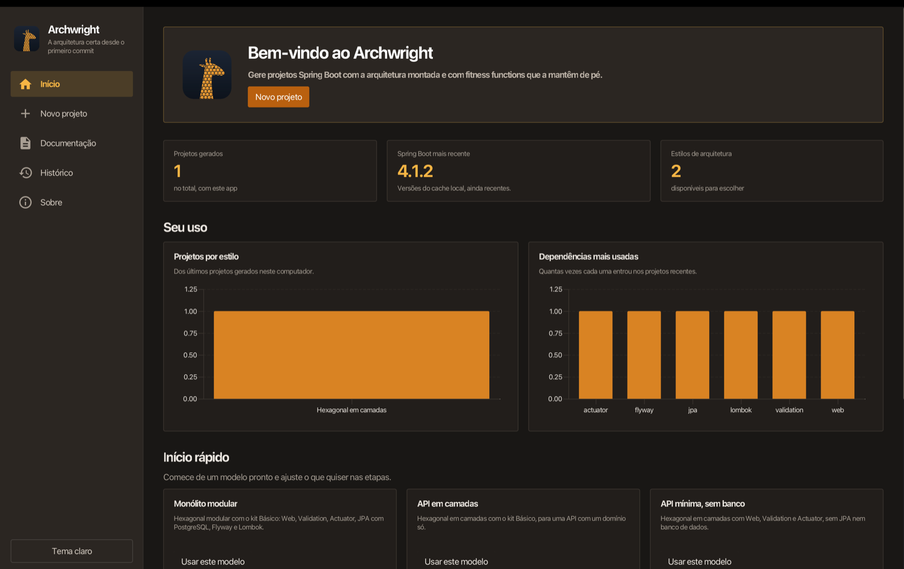
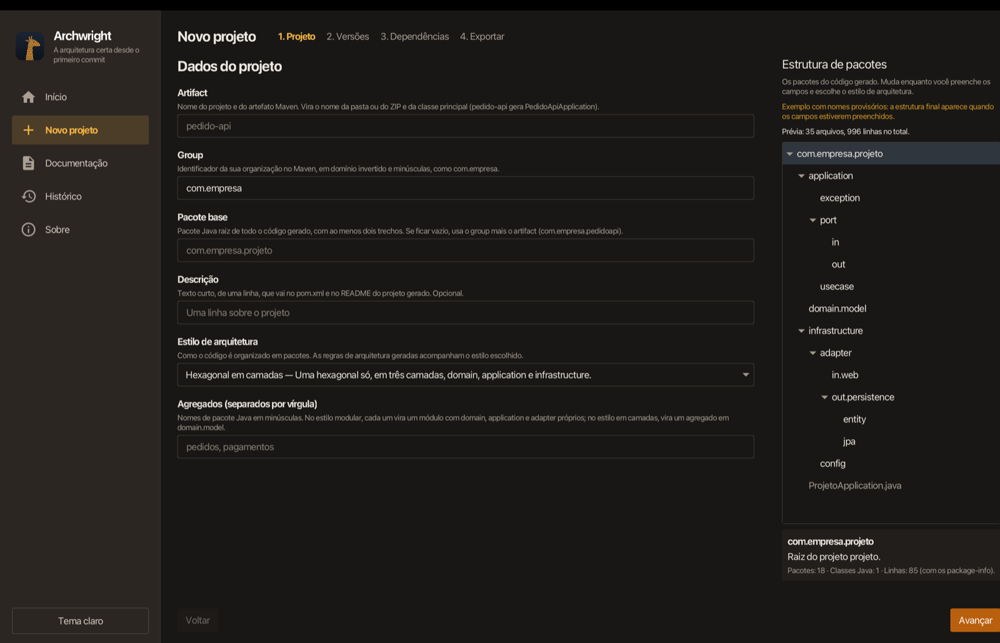
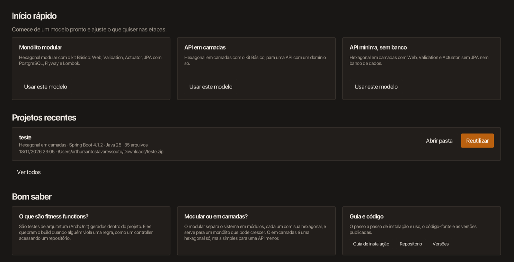
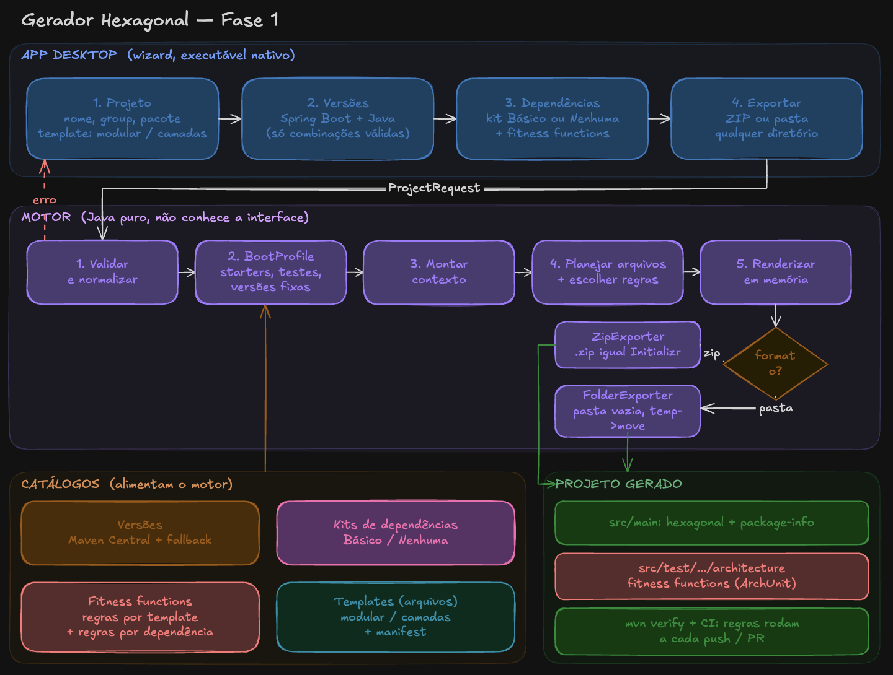

# Archwright

**Gerador de projetos Spring Boot com a arquitetura certa desde o primeiro commit, e fitness functions que mantêm ela certa.**

*Architecture-first project generator for Spring Boot — hexagonal today, more styles soon. Fitness functions included.*

> **Pré-lançamento [v0.3.0](https://github.com/arthur-souto/archwright/releases/tag/v0.3.0).** O motor e o app desktop funcionam (a v0.3.0 faz o projeto gerado já vir com as exceções padrão e o tratamento de erros HTTP), e há instaladores para macOS, Windows e Linux. Eles ainda não são assinados (o sistema mostra um aviso na primeira abertura) e o do Windows e o do Linux ainda não foram testados em máquina real. Veja [o que ainda falta](#limitações-conhecidas).

## O que é

O Spring Initializr gera um projeto vazio: a estrutura de pacotes e as regras de arquitetura ficam por sua conta. O Archwright faz o mesmo papel (você escolhe versões e dependências e recebe um ZIP ou uma pasta), mas o projeto já sai:

- **com a arquitetura montada:** pacotes de domínio, aplicação (portas e casos de uso) e adapters, cada um com um `package-info.java` explicando a responsabilidade dele;
- **com fitness functions:** testes ArchUnit que quebram o build quando alguém viola a arquitetura (um controller acessando repositório, JPA dentro do domínio, um módulo usando a parte interna de outro);
- **compilando de primeira:** toda combinação de versão do Spring Boot, estilo e kit é gerada e testada no CI do Archwright.

## Instalar e usar

**Você não precisa de Java para usar o app**: o instalador já leva um dentro. Só o projeto gerado precisa de um JDK para compilar.

1. Baixe o instalador do seu sistema na página de [Releases](https://github.com/arthur-souto/archwright/releases):

   | Sistema | Arquivo |
   |---|---|
   | macOS (Apple Silicon: M1, M2, M3…) | `Archwright-1.0.0-macos-arm64.dmg` |
   | macOS (Intel) | `Archwright-1.0.0-macos-x64.dmg` |
   | Windows 10 ou 11 | `Archwright-1.0.0-windows-x64.msi` |
   | Linux (Debian, Ubuntu e derivados) | `archwright_1.0.0_amd64-linux-x64.deb` |

   O `1.0.0` no nome é só o número do instalador (o macOS recusa versões começando em 0). A versão do Archwright é a da release.

2. Instale. No macOS o `.dmg` **não instala sozinho**: arraste o Archwright para a pasta Applications. Como os instaladores não são assinados, na primeira abertura use clique direito > **Abrir** (macOS) ou **Mais informações** > **Executar assim mesmo** (Windows). O passo a passo completo, com o que fazer se o sistema bloquear, está no **[INSTALL.md](INSTALL.md)**.

3. Abra o app e percorra as 4 etapas.

## As 4 etapas

Cada campo tem uma descrição logo abaixo do título, e uma **árvore de pacotes ao vivo** no canto direito mostra a estrutura que será gerada, mudando enquanto você digita. Clicar num pacote mostra para que ele serve, quantas classes e linhas ele tem. Se algum campo ainda estiver incompleto, a árvore mostra um exemplo com nomes provisórios e avisa.

1. **Projeto:** nome (artifact), group, pacote base (se vazio, usa o group mais o artifact; precisa de ao menos dois trechos), descrição e estilo de arquitetura.
2. **Versões:** Spring Boot (do 2.7 ao mais recente, a lista vem do Maven Central) e Java, só em combinações válidas. Sem internet, o app usa uma lista que vem com ele e avisa.
3. **Dependências:** kit **Básico** (Web, Validation, Actuator, JPA + PostgreSQL, Flyway, Lombok) ou **Nenhum**, com ajuste fino. Cada dependência mostra o que faz e o artifact Maven que entra no `pom.xml`. Aqui você marca os extras (Docker Compose com PostgreSQL, GitHub Actions) e as **fitness functions**, com a explicação de cada regra.
4. **Exportar:** formato ZIP ou pasta, destino, e **Gerar projeto**. O resumo mostra os arquivos, as dependências e as regras. O botão **Abrir pasta** leva ao resultado.

O app abre numa **tela de início** com números, gráficos do seu uso, modelos de início rápido e os projetos recentes. A barra lateral leva ao **Histórico** (reutilize as escolhas de um projeto já gerado), à **Documentação** e ao tema claro/escuro. O app lembra as últimas escolhas (group, estilo, kit, formato, destino e tema).

Na tela de início ficam os modelos de início rápido, os projetos recentes e as dicas:

## Estilos de arquitetura

| Estilo | Para quê | Status |
|---|---|---|
| Hexagonal modular | monólito modular: vários módulos, cada um com hexagonal própria, shared kernel e bootstrap | disponível |
| Hexagonal em camadas | uma hexagonal só: `domain`, `application`, `infrastructure`, com os agregados em `domain.model` | disponível |
| Clean, Onion, camadas tradicionais | — | [Fase 5](docs/implementation/ROADMAP.md#fase-5--novos-estilos-de-arquitetura) |

Os dois estilos já geram, em Java puro, as exceções padrão (`DomainException`, `ResourceNotFoundException`, `ConflictException` e `BusinessRuleException`) e, com a dependência `web`, um `GlobalExceptionHandler` que as traduz em respostas HTTP no formato `problem+json` (RFC 9457), inclusive no Spring Boot 2.7. Os pacotes de persistência só existem quando o projeto usa `jpa`.

O que cada estilo gera, arquivo por arquivo, está em [Projeto gerado](docs/contracts/GENERATED_PROJECT.md).

## Depois de gerar

Descompacte o ZIP (ou abra a pasta) e, dentro do projeto, com um JDK na versão que você escolheu:

    ./mvnw verify

Isso compila, roda os testes e as fitness functions. Na primeira vez o Maven Wrapper baixa o Maven, então precisa de internet. Se alguém violar a arquitetura, o build quebra. O `README.md` do projeto gerado explica a estrutura e como congelar uma regra que já estava violada. Com o extra do Docker Compose, `docker compose up -d` sobe o PostgreSQL local (copie o `.env.example` para `.env`).

## Privacidade

O app roda inteiro no seu computador. A única coisa que ele busca na internet é a lista de versões do Spring Boot, no Maven Central. Os dados do projeto que você preenche não são enviados a lugar nenhum.

## Limitações conhecidas

- **Sem assinatura:** os instaladores mostram um aviso de app não verificado na primeira abertura (veja o [INSTALL.md](INSTALL.md)).
- **Windows e Linux:** o `.msi` e o `.deb` são gerados no CI e são válidos, mas ainda não foram instalados e abertos numa máquina real. O instalador do macOS já foi.
- **Idioma:** a interface está só em português do Brasil.
- **Só Maven:** o projeto gerado usa Maven. Gradle e Kotlin estão na [Fase 6](docs/implementation/ROADMAP.md#fase-6--projetos-existentes-e-outros-builds).
- **O engine ainda não está no Maven Central:** quem quiser usá-lo como biblioteca precisa construí-lo do código.

Problemas comuns de uso (pasta de destino inexistente, arquivo já existente, sem conexão) estão no [INSTALL.md](INSTALL.md#problemas-comuns).

## Para desenvolvedores

Precisa de JDK 25.

**Rodar o app a partir do código:**

    ./mvnw -pl .,archwright-engine install -DskipTests
    ./mvnw -pl archwright-desktop exec:java

O primeiro comando instala o POM pai e o engine no repositório Maven local (refaça sempre que o engine mudar); o segundo abre o wizard.

**Testes:** `./mvnw verify` roda o engine (inclui os testes golden e as regras de arquitetura do próprio Archwright) e o desktop. Os testes de tela precisam de um ambiente gráfico e são pulados quando não há (por exemplo, no CI em Linux). A matriz que compila os projetos gerados roda à parte, no workflow [`Generated projects`](.github/workflows/generated-projects.yml).

**Gerar o instalador do seu sistema:**

    ./mvnw -B -Pinstaller -pl archwright-desktop -am package -DskipTests

O arquivo sai em `archwright-desktop/target/installer/dist/`. O `jpackage` não faz instalador para outro sistema: `.dmg` no macOS, `.msi` no Windows (precisa do [WiX 3](https://wixtoolset.org/), que os runners do GitHub já trazem) e `.deb` no Linux. O ícone (uma girafa de mosaico hexagonal) vem de [`archwright.svg`](archwright-desktop/packaging/archwright.svg), com `.icns`, `.ico` e `.png` na mesma pasta.

**Publicar uma versão:** as releases saem do workflow [`Installers`](.github/workflows/installers.yml), que gera os instaladores nos quatro alvos (macOS arm64 e Intel, Windows e Linux). Enviar uma tag `v*` publica uma release como pré-lançamento; rodá-lo à mão só gera os arquivos, sem release. Mudanças na `main` **não** atualizam releases já publicadas: cada versão nova precisa de uma tag nova (`v0.1.1`, `v0.2.0`…), e uma tag já usada não pode ser reenviada.

## Documentação

| Documento | Conteúdo |
|---|---|
| [Instalação](INSTALL.md) | baixar, instalar e usar o app |
| [Roadmap](docs/implementation/ROADMAP.md) | fases, critérios de pronto e próxima tarefa |
| [Regras de negócio](docs/domain/BUSINESS_RULES.md) | regras `BR-*` testáveis |
| [Arquitetura](docs/architecture/ARCHITECTURE.md) | módulos, pacotes e a especificação de cada etapa do motor |
| [API do engine](docs/contracts/ENGINE_API.md) | contrato Java usado pelas interfaces |
| [Formato de templates](docs/contracts/TEMPLATE_FORMAT.md) | manifest, contexto e catálogos |
| [Projeto gerado](docs/contracts/GENERATED_PROJECT.md) | o que cada estilo gera e o catálogo de fitness functions |
| [Testes](docs/operations/TESTING.md) | pirâmide, golden files, matriz de compilação e roteiro manual do desktop |
| [ADRs](docs/adr/) | decisões de arquitetura |

## Inspiração

A estrutura dos estilos vem de dois projetos reais: [Hexbank](https://github.com/arthur-souto/Hexbank) (monólito modular hexagonal) e [Liva](https://github.com/arthur-souto/liva) (hexagonal em camadas).

## Licença

Apache 2.0 (veja o arquivo [`LICENSE`](LICENSE)).

*Spring e Spring Boot são marcas registradas da Broadcom Inc. O Archwright é um projeto independente, sem vínculo com o projeto Spring.*
