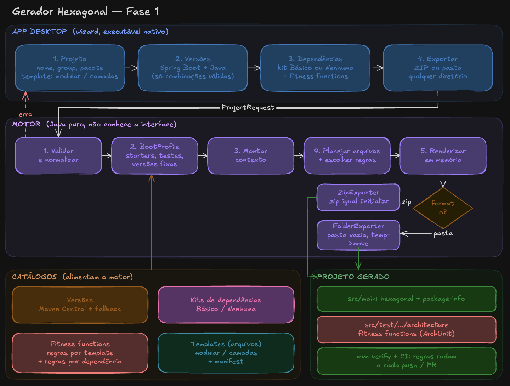

# Arquitetura do Archwright

## Decisão
Um build Maven com dois módulos: **`archwright-engine`**, uma biblioteca Java pura que valida, planeja, renderiza e exporta projetos, e **`archwright-desktop`**, o app JavaFX que só coleta escolhas e chama o engine ([ADR-0001](../adr/0001-motor-independente-e-hexagonal.md), [ADR-0002](../adr/0002-desktop-javafx-atlantafx.md)). O engine segue a mesma arquitetura hexagonal que gera e roda as mesmas fitness functions.

## Visão geral

```text
┌──────────────── archwright-desktop (JavaFX) ────────────────┐
│ 1. Projeto  →  2. Versões  →  3. Dependências  →  4. Exportar │
└──────────────────────────────┬───────────────────────────────┘
                               │ ProjectRequest + ExportTarget
┌──────────────── archwright-engine ──────────────▼──────────────┐
│ 1 Validar → 2 BootProfile → 3 Contexto → 4 Planejar → 5 Renderizar │
│                                                    │            │
│                                       6 Exportar: ZIP | PASTA   │
└───▲──────────────▲──────────────▲──────────────▲────────────────┘
    │ versões      │ kits/deps    │ fitness rules │ templates
    └──────── catálogos (YAML + templates Mustache, embutidos) ──┘
```

### Diagrama da Fase 1



Como ler:

- **App desktop → motor:** o wizard monta um `ProjectRequest` (mais o `ExportTarget`) e o entrega ao motor. O motor não conhece a interface.
- **Erro volta para o wizard:** se a etapa 1 devolver violações, elas retornam à tela correspondente ([ENG-VAL](#etapa-1--validar-e-normalizar-eng-val)); nada é renderizado nem gravado.
- **Catálogos → motor:** versões (Maven Central + fallback), estilos, dependências, extras, regras de fitness functions e templates alimentam o motor como dados (kits e regras de estilo são estratégias em código) ([ADR-0003](../adr/0003-templates-e-catalogos-como-dados.md)). No diagrama a seta sai das versões para o `BootProfile` (etapa 2); estilos, dependências e extras, regras e templates são lidos nas etapas 1, 4 e 5. Os kits (Básico e Nenhum) não são dados de catálogo: vivem em código, como estratégias, e por isso não aparecem entre os catálogos.
- **Exportação:** na etapa 6 o formato decide o adapter. `ZipExporter` gera um `.zip` igual ao do Initializr; `FolderExporter` grava numa pasta vazia, usando diretório temporário e `move` ao final ([ENG-EXP](#etapa-6--exportar-eng-exp)).
- **Projeto gerado:** `src/main` hexagonal com `package-info`, fitness functions ArchUnit em `src/test/.../architecture` e `mvn verify` + CI, de modo que as regras rodam a cada push/PR ([GENERATED_PROJECT](../contracts/GENERATED_PROJECT.md)).

## Módulos Maven

| Módulo | Conteúdo | Depende de |
|---|---|---|
| `archwright-engine` | domínio, casos de uso, catálogos, templates, exportadores | JDK, SnakeYAML, JMustache, Apache Commons Compress |
| `archwright-desktop` | telas JavaFX + AtlantaFX, empacotamento `jpackage` | `archwright-engine` (somente `application.port.in` e `config`) |

Os dois módulos usam **Java 25** e são compilados com `--release 25`. Os projetos gerados podem usar qualquer Java suportado (BR-021); a versão do Archwright não limita a do projeto gerado.

## Pacotes do engine

```text
io.github.arthursouto.archwright.engine
├── domain/
│   ├── model/        # ProjectSpec, ProjectIdentity, ArtifactId, GroupId, BasePackage, Description, ModuleName,
│   │                 # Architecture, ArchitectureStyle, BootVersion, JavaVersion, BootProfile, Catalog,
│   │                 # DependencyId, DependencyDefinition, ExtraId, ExtraDefinition, KitId, MavenCoordinate,
│   │                 # PersistenceNamespace, TestStrategy, TemplateContext,
│   │                 # Manifest, ManifestFile, ManifestPackage, Repeat, LineEnding,
│   │                 # FilePlan, PlannedFile, GeneratedProject, GeneratedFile
│   ├── style/        # ArchitectureStyleStrategy, HexagonalModularStyle, HexagonalLayeredStyle, ArchitectureStyles
│   ├── kit/          # KitStrategy, NoneKit, BasicKit, Kits
│   ├── validation/   # ProjectDraft, Violation, Warning, ViolationCode, WarningCode, ValidationResult, SpecValidator
│   │                 # (regras BR-001 a BR-034; um validador interno por assunto)
│   └── naming/       # Names, PackageSegments, Escaping (puros)
├── application/
│   ├── port/in/      # GenerateProjectUseCase, PreviewProjectQuery, CatalogQuery + DTOs (ProjectRequest, ExportTarget, ...)
│   ├── port/out/     # BootVersionSource, VersionCache, CachedVersions, EmbeddedVersions, CatalogRepository, TemplateRepository,
│   │                 # TemplateRenderer, ProjectExporter, ExportResult
│   └── usecase/      # GenerateProject, PreviewProject, BrowseCatalog, ProfileResolver, BootVersionLookup, CatalogVerifier,
│                     # ContextBuilder, FilePlanner, ProjectRenderer
├── adapter/
│   └── out/
│       ├── version/  # MavenCentralBootVersionSource, FileVersionCache, EmbeddedBootVersions
│       ├── yaml/     # YamlResources, YamlRow (leitura estrita de YAML, usada por catálogo e templates)
│       ├── catalog/  # YamlCatalogRepository (classpath)
│       ├── template/ # ClasspathTemplateRepository, MustacheTemplateRenderer
│       └── export/   # ZipProjectExporter, FolderProjectExporter
└── config/           # ArchwrightEngine: monta tudo e expõe as portas de entrada
```

Recursos (não são código):

```text
archwright-engine/src/main/resources/archwright/
├── catalog/        # styles.yaml, boot-profiles.yaml, dependencies.yaml, extras.yaml, fitness-rules.yaml, boot-versions.txt
├── templates/
│   ├── common/             # pom.xml, application.yaml, .gitignore, README.md, mvnw, docker-compose.yml, ci.yml
│   ├── hexagonal-modular/  # manifest.yaml + arquivos do estilo
│   └── hexagonal-layered/  # manifest.yaml + arquivos do estilo
└── fitness/        # templates das classes de teste ArchUnit, uma por grupo de regras
```

## Regras de dependência (fitness functions do próprio engine)

| Id | Regra |
|---|---|
| AW-FF-01 | `adapter → application → domain`, nunca ao contrário; `config` pode ver todos. |
| AW-FF-02 | `domain` não depende de SnakeYAML, JMustache, `java.io.File`, `java.nio.file`, `java.net` nem `java.util.zip`: o domínio não faz E/S. |
| AW-FF-03 | `application` não depende de SnakeYAML nem JMustache (só de portas). |
| AW-FF-04 | Tipos em `port.in` e `port.out` são interfaces, records ou enums. |
| AW-FF-05 | O módulo `archwright-desktop` só importa `..engine.application.port.in..` e `..engine.config..`. |
| AW-FF-06 | Sem ciclos entre pacotes. |
| AW-FF-07 | `application.port.in` é autocontido: não depende de `domain`, `port.out` nem `usecase`. É o que permite ao desktop usar só `port.in` e `config` (AW-FF-05). |
| AW-FF-08 | No desktop, `wizard`, `i18n` e `preferences` não dependem de `view`: o modelo e as mensagens não conhecem as telas. |

Ficam em `archwright-engine/src/test/java/.../architecture/EngineArchitectureTest.java` e `archwright-desktop/src/test/java/.../architecture/DesktopArchitectureTest.java`.

## Como ler as especificações
Cada etapa abaixo segue o [modelo de especificação](../implementation/SPEC_TEMPLATE.md): status, regras de origem, contrato e critérios de aceite em tabela *Dado / Quando / Então*. Cada linha da tabela vira ao menos um teste, que cita o id (`ENG-VAL-01 #3`) no nome ou num comentário. Prefixos em uso:

| Prefixo | Assunto |
|---|---|
| `ENG-CAT` | carregamento e validação dos catálogos |
| `ENG-VER` | lista de versões do Spring Boot |
| `ENG-VAL` | etapa 1: validar e normalizar |
| `ENG-BPR` | etapa 2: resolver o `BootProfile` |
| `ENG-CTX` | etapa 3: montar contexto |
| `ENG-PLN` | etapa 4: planejar arquivos e escolher fitness functions |
| `ENG-RND` | etapa 5: renderizar |
| `ENG-EXP` | etapa 6: exportar |
| `ENG-UC` | casos de uso (portas de entrada) |

---

## Catálogos (`ENG-CAT`)
**Status:** ✅ implementado para `styles`, `boot-profiles`, `dependencies`, `extras` e `fitness-rules`.
Regras: [BR-020](../domain/BUSINESS_RULES.md#versões), [BR-030](../domain/BUSINESS_RULES.md#dependências-e-kits), [BR-031](../domain/BUSINESS_RULES.md#dependências-e-kits), [BR-041](../domain/BUSINESS_RULES.md#fitness-functions), [ADR-0003](../adr/0003-templates-e-catalogos-como-dados.md). Formato: [TEMPLATE_FORMAT](../contracts/TEMPLATE_FORMAT.md#catálogos).

Lê os YAML do classpath uma vez, valida a consistência entre eles e entrega objetos imutáveis. Estilos e kits têm regras em código ([ADR-0003](../adr/0003-templates-e-catalogos-como-dados.md), item 6); o catálogo só confere que o que elas citam existe nos YAML. Um catálogo inválido é bug do Archwright: falha na inicialização do engine e no build (teste dedicado), nunca na mão do usuário.

**Contrato**

    public interface CatalogRepository {
        List<BootProfile> bootProfiles();        // ordenados da linha mais nova para a mais antiga
        List<DependencyDefinition> dependencies();
        List<ExtraDefinition> extras();
        List<FitnessRuleDefinition> fitnessRules();
        List<ArchitectureStyleDefinition> styles();
    }
    // YamlCatalogRepository lança IllegalStateException("catalog: <arquivo>: <problema>") se inválido

#### ENG-CAT-01 — Catálogos consistentes
> **Como** mantenedor, **quero** que um catálogo quebrado falhe o build, **para** nunca distribuir uma versão que gere projetos errados.

| # | Dado | Quando | Então |
|---|---|---|---|
| 1 | catálogos oficiais do repositório | engine inicia | carrega sem erro; 2 estilos, ≥ 9 perfis; `Kits.standard()` com `NONE` e `BASIC` |
| 2 | kit (estratégia) referencia dependência `foo` que não existe em `dependencies.yaml` | engine inicia | `IllegalStateException` citando o kit e `foo` |
| 3 | dois perfis com a mesma linha `3.5` | carregar | exceção citando `boot-profiles.yaml` e `3.5` |
| 4 | perfil com `artifacts` de uma dependência que não existe em `dependencies.yaml` (a disponibilidade por versão é definida pelas chaves de `artifacts`) | carregar | exceção citando o perfil e a dependência |
| 5 | regra de fitness function referencia template inexistente | engine inicia | exceção citando a classe de teste e o caminho (`FitnessTemplateVerifier`); ids de regra duplicados ou fora do padrão `FF-XXX-NN` falham ao carregar |
| 6 | perfil com `javaMin` > `javaMaxTested` | carregar | exceção citando a linha |
| 7 | estilo em `styles.yaml` sem estratégia registrada em `ArchitectureStyles` | engine inicia | `IllegalStateException` citando o estilo (`CatalogVerifier`) |

Também verificados: arquivo ausente, vazio ou malformado, chave YAML duplicada, `line` sem aspas (YAML leria `3.10` como número), campo obrigatório ausente (cita a entrada), id duplicado, `implies` e `requires` com dependência inexistente, estilo desconhecido ou ausente. Os perfis saem ordenados pela linha, numericamente.

**Pronto quando:** `CatalogConsistencyTest` (catálogos quebrados num diretório temporário, lidos pelo classpath), `OfficialCatalogTest` (#1) e `CatalogVerifierTest` (#2) cobrem #1 a #4, #6 e #7. O `boot-profiles.yaml` já traz as coordenadas Maven, mas só as chaves de `artifacts` são lidas até o [ENG-BPR](#etapa-2--resolver-o-bootprofile-eng-bpr); os valores foram confirmados pela matriz de compilação.

---

## Versões do Spring Boot (`ENG-VER`)
**Status:** ✅ implementado (`BootVersionLookup`, `MavenCentralBootVersionSource`, `FileVersionCache`, `EmbeddedBootVersions`).
Regras: [BR-020](../domain/BUSINESS_RULES.md#versões), [BR-022](../domain/BUSINESS_RULES.md#versões), [BR-023](../domain/BUSINESS_RULES.md#versões), [BR-072](../domain/BUSINESS_RULES.md#erros-avisos-e-privacidade).

Monta a lista de versões oferecida na tela 2, com fallback em cadeia.

**Contrato**

    public interface BootVersionSource { List<String> fetch() throws IOException; } // Maven Central, timeout total 8 s
    public interface VersionCache {
        Optional<CachedVersions> read();            // versões + instante da gravação
        void write(List<String> versions, Instant at);
    }
    public interface EmbeddedVersions { List<String> versions(); }   // catalog/boot-versions.txt
    // cache em <home do usuário>/.archwright/cache/boot-versions.json; gravação em melhor esforço
    // (falha de E/S não derruba a consulta); arquivo ilegível ou corrompido = sem cache
    // o cache guarda a lista crua do Maven Central, filtrada a cada leitura (o arquivo é compartilhado
    // entre versões do Archwright, cujos catálogos podem ter linhas diferentes)

Ordem da consulta (`BootVersionLookup`): **1)** cache com menos de 24 h, sem tocar a rede; **2)** Maven Central (só o `maven-metadata.xml`, sem enviar dado do usuário; limite total de 8 s), gravando o cache; **3)** cache mais antigo; **4)** lista embutida. Uma origem cuja lista, depois do filtro, fique vazia é descartada e a cadeia segue; resposta remota inutilizável não sobrescreve o cache. `fetchedAt` é o instante da gravação do cache ou da consulta remota, e `null` quando a origem é `EMBEDDED`. Um cache com data no futuro nunca é considerado fresco.

Filtro aplicado sobre qualquer origem: só `x.y.z` estáveis, `>= 2.7.0`, cuja linha exista no catálogo; ordenadas da mais nova para a mais antiga.

#### ENG-VER-01 — Lista de versões com fallback
> **Como** usuário, **quero** ver as versões atuais do Spring Boot mesmo sem internet, **para** nunca ficar impedido de gerar (BR-023).

| # | Dado | Quando | Então |
|---|---|---|---|
| 1 | Maven Central responde `4.1.2, 4.1.1, 4.2.0-M1, 2.6.9` | listar | `[4.1.2, 4.1.1]`, origem `REMOTE`; cache gravado |
| 2 | Maven Central fora; cache gravado há 3 h | listar | versões do cache, origem `CACHE` |
| 3 | Maven Central fora; cache gravado há 3 dias | listar | versões do cache, origem `STALE_CACHE` |
| 4 | Maven Central fora; sem cache | listar | lista embutida (`boot-versions.txt`), origem `EMBEDDED` |
| 5 | Maven Central demora 30 s | listar | desiste em 8 s e cai no item #2, #3 ou #4 |
| 6 | Maven Central devolve `5.0.0` e não existe perfil `5.0` | listar | `5.0.0` não aparece |
| 7 | arquivo de cache corrompido | listar | ignora o cache, segue a cadeia, regrava se o remoto responder |
| 8 | cache fresco (< 24 h) | listar | **não** chama o Maven Central |

**Fora do escopo:** atualizar o catálogo de perfis remotamente (perfis só mudam com nova versão do Archwright).
**Pronto quando:** `BootVersionsTest` (fakes de `BootVersionSource` e `VersionCache`, relógio fixo) cobre #1 a #8; `MavenMetadataParserTest` cobre o parser do XML com arquivo de exemplo (inclusive recusa de DOCTYPE); `MavenCentralBootVersionSourceTest` (servidor HTTP local, nunca a rede real) cobre o limite de tempo da #5 e o BR-072; `FileVersionCacheTest` cobre cache corrompido e gravação em melhor esforço; `EmbeddedBootVersionsTest` garante que a lista embutida cobre todas as linhas do catálogo oficial. A lista embutida deve ser regenerada a cada release do Archwright.

---

## Etapa 1 — Validar e normalizar (`ENG-VAL`)
**Status:** ✅ implementado (`SpecValidatorTest` e um teste por validador).
Regras: [BR-001 a BR-005](../domain/BUSINESS_RULES.md#identificação-do-projeto), [BR-010 a BR-012](../domain/BUSINESS_RULES.md#estilo-de-arquitetura), [BR-020 a BR-024](../domain/BUSINESS_RULES.md#versões), [BR-030 a BR-034](../domain/BUSINESS_RULES.md#dependências-e-kits), [BR-070](../domain/BUSINESS_RULES.md#erros-avisos-e-privacidade).
Depende de: [catálogos](#catálogos-eng-cat).

Transforma o `ProjectDraft` (strings cruas, com nulos já normalizados) num `ProjectSpec` (tipos de domínio válidos) ou numa lista com **todas** as violações. O caso de uso converte o `ProjectRequest` (`application.port.in`) em `ProjectDraft`, porque o domínio não pode depender da aplicação (AW-FF-01). Lógica pura, no `domain`, sem E/S. A verificação do destino de exportação (BR-061 a BR-063) **não** é feita aqui: é do exportador ([ENG-EXP](#etapa-6--exportar-eng-exp)).

**Contrato**

    public sealed interface ValidationResult {
        record Valid(ProjectSpec spec, List<Warning> warnings) implements ValidationResult {}
        record Invalid(List<Violation> violations) implements ValidationResult {}
    }
    public SpecValidator(Catalog catalog, ArchitectureStyles styles, Kits kits);
    public ValidationResult SpecValidator.validate(ProjectDraft draft);
    public record Violation(ViolationCode code, String field, Map<String, String> params) {}

#### ENG-VAL-01 — Identificação do projeto
> **Como** usuário, **quero** saber exatamente o que está errado nos nomes, **para** corrigir tudo de uma vez (BR-001 a BR-005, BR-070).

| # | Dado | Quando | Então |
|---|---|---|---|
| 1 | `artifactId=" Pedido-API "`, `groupId="com.acme"`, pacote vazio | validar | válido; `artifactId=pedido-api`, pacote `com.acme.pedidoapi`, classe `PedidoApiApplication` |
| 2 | `artifactId="pedido_api"` | validar | `INVALID_ARTIFACT_ID` em `artifactId` |
| 3 | `artifactId` com 65 caracteres válidos | validar | `INVALID_ARTIFACT_ID` |
| 4 | `groupId="com..acme"` | validar | `INVALID_GROUP_ID` |
| 5 | pacote `"com.acme.new"` | validar | `INVALID_BASE_PACKAGE` com `params.segment=new` |
| 6 | `artifactId="1app"` (inválido) e `groupId=""` | validar | **duas** violações, na ordem dos campos |
| 7 | `artifactId="3d-viewer"` (começa com dígito) | validar | `INVALID_ARTIFACT_ID` |
| 8 | descrição com quebra de linha | validar | `INVALID_DESCRIPTION` |
| 9 | descrição `"API <beta> & cia"` | validar | válido; escapar é responsabilidade do contexto ([ENG-CTX-01 #4](#etapa-3--montar-contexto-eng-ctx)) |
| 10 | pacote `"main"` (um trecho só) | validar | `BASE_PACKAGE_TOO_SHORT` em `basePackage`; `"new"` continua `INVALID_BASE_PACKAGE` |

#### ENG-VAL-02 — Estilo e módulos
> **Como** usuário, **quero** escolher a arquitetura e os módulos sem gerar pacotes inválidos (BR-010 a BR-012).

| # | Dado | Quando | Então |
|---|---|---|---|
| 1 | `HEXAGONAL_MODULAR`, módulos `["Pedidos", " pagamentos "]` | validar | válido; módulos `pedidos`, `pagamentos` (ordem preservada) |
| 2 | `HEXAGONAL_MODULAR`, módulos `[]` | validar | `MODULES_REQUIRED` |
| 3 | `HEXAGONAL_MODULAR`, módulos `["shared"]` | validar | `RESERVED_MODULE_NAME` com `params.name=shared` |
| 4 | módulos `["pedidos", "PEDIDOS"]` | validar | `DUPLICATED_MODULE_NAME` |
| 5 | 21 módulos | validar | `TOO_MANY_MODULES` |
| 6 | `HEXAGONAL_LAYERED`, agregados `[]` | validar | válido |
| 7 | `HEXAGONAL_LAYERED`, agregados `["shared"]` | validar | válido (palavra reservada só vale para o estilo modular) |
| 8 | estilo `"ONION"` | validar | `UNKNOWN_ARCHITECTURE_STYLE` |

#### ENG-VAL-03 — Versões
> **Como** usuário, **quero** que o gerador recuse combinações que não compilam (BR-020 a BR-024).

| # | Dado | Quando | Então |
|---|---|---|---|
| 1 | Boot `3.5.3`, Java `21` | validar | válido, sem avisos |
| 2 | Boot `3.2.0`, Java `11` | validar | `INCOMPATIBLE_JAVA_VERSION` com `params.min=17` |
| 3 | Boot `2.7.18`, Java `8` | validar | válido, aviso `LEGACY_BOOT_LINE` |
| 4 | Boot `4.1.2`, Java acima do `javaMaxTested` da linha 4.1 | validar | válido, aviso `JAVA_ABOVE_TESTED` |
| 5 | Boot `3.5.0-RC1` | validar | `UNSUPPORTED_BOOT_VERSION` |
| 6 | Boot `2.6.15` | validar | `UNSUPPORTED_BOOT_VERSION` |
| 7 | Boot `9.0.0` (linha fora do catálogo) | validar | `UNSUPPORTED_BOOT_VERSION` |
| 8 | Java `10` | validar | `UNSUPPORTED_JAVA_VERSION` |

#### ENG-VAL-04 — Dependências, kits e extras
> **Como** usuário, **quero** partir de um kit e ajustar, sem montar combinações quebradas (BR-030 a BR-034).

| # | Dado | Quando | Então |
|---|---|---|---|
| 1 | kit `BASIC`, dependências exatamente as do kit | validar | válido; 6 dependências |
| 2 | kit `NONE`, dependências `[]` | validar | válido; 0 dependências |
| 3 | dependências `["flyway"]` | validar | válido; `jpa` incluída; aviso `DEPENDENCY_ADDED` com `params.added=jpa`, `params.by=flyway` |
| 4 | dependências `["springdoc"]` | validar | `web` incluída; aviso `DEPENDENCY_ADDED` |
| 5 | dependências `["kafka"]` (não existe) | validar | `UNKNOWN_DEPENDENCY` |
| 6 | dependência existente, fora da faixa da versão escolhida | validar | `DEPENDENCY_NOT_AVAILABLE` com `params.boot` |
| 7 | extra `docker-compose` sem `jpa` | validar | `EXTRA_REQUIRES_DEPENDENCY` com `params.requires=jpa` |
| 8 | dependências `["web", "web"]` | validar | válido; `web` uma vez só |
| 9 | kit `"PREMIUM"` (fora do registro `Kits`) ou vazio | validar | `UNKNOWN_KIT` com `params.value` |

**Pronto quando:** `SpecValidatorTest` (domínio puro, catálogo montado em memória) cobre ENG-VAL-01 a 04.

---

## Etapa 2 — Resolver o `BootProfile` (`ENG-BPR`)
**Status:** ✅ implementado (`ProfileResolver`, `BootProfile`, `TestStrategy`).
Regras: [BR-020](../domain/BUSINESS_RULES.md#versões), [BR-030](../domain/BUSINESS_RULES.md#dependências-e-kits), [BR-041](../domain/BUSINESS_RULES.md#fitness-functions).

Toda diferença entre gerações do Spring Boot mora aqui, em dados (`boot-profiles.yaml`), e nunca nos templates. O `BootProfile` responde: qual o Java mínimo e o máximo testado, se usa `javax` ou `jakarta`, qual artefato Maven corresponde a cada dependência do catálogo, quais starters de teste usar e quais versões fixar fora do BOM do Spring Boot.

**Campos**

| Campo | Tipo | Regra |
|---|---|---|
| `line` | `String` | `x.y`, único no catálogo |
| `javaMin` / `javaMaxTested` | `int` | `javaMin <= javaMaxTested` |
| `legacy` | `boolean` | gera aviso `LEGACY_BOOT_LINE` |
| `persistenceNamespace` | `javax` \| `jakarta` | usado pelas fitness functions de persistência |
| `artifacts` | `Map<DependencyId, List<MavenCoordinate>>` | dependência → artefatos (com escopo e versão quando não gerenciada pelo Boot) |
| `testStrategy` | `TestStrategy` | `SINGLE_STARTER` (2.x/3.x): `spring-boot-starter-test` mais os `testArtifacts` das dependências escolhidas. `PER_TECHNOLOGY` (4.x): só os `testArtifacts` das dependências escolhidas, ou `spring-boot-starter-test` se nenhuma tiver |
| `testArtifacts` | `Map<DependencyId, List<MavenCoordinate>>` | opcional; só para dependências que têm `artifacts` no mesmo perfil |
| `pinnedVersions` | `Map<String, String>` | propriedades do `pom.xml` (ex.: `springdoc.version`, `archunit.version`) |

### Perfis de versão iniciais
Valores do `boot-profiles.yaml`, confirmados pela [matriz de compilação](../operations/TESTING.md#matriz-de-compilação) (53 jobs verdes no GitHub em 2026-11-18: todas as linhas, os dois estilos, os dois kits, Java 8, 21 a 25, com `springdoc` e `security` nos casos `BASIC`).

| Linha | Java mín. | Java máx. testado | Namespace | Web | Flyway | `flyway-database-postgresql` | Testes | SpringDoc |
|---|---|---|---|---|---|---|---|---|
| 2.7 (legacy) | 8 | 21 | `javax` | `spring-boot-starter-web` | `flyway-core` | não | starter único | `springdoc-openapi-ui` 1.8.0 |
| 3.0 | 17 | 21 | `jakarta` | `spring-boot-starter-web` | `flyway-core` | não | starter único | 2.1.0 |
| 3.1 | 17 | 21 | `jakarta` | `spring-boot-starter-web` | `flyway-core` | não | starter único | 2.2.0 |
| 3.2 | 17 | 21 | `jakarta` | `spring-boot-starter-web` | `flyway-core` | não | starter único | 2.5.0 |
| 3.3 | 17 | 22 | `jakarta` | `spring-boot-starter-web` | `flyway-core` | sim | starter único | 2.6.0 |
| 3.4 | 17 | 23 | `jakarta` | `spring-boot-starter-web` | `flyway-core` | sim | starter único | 2.8.x |
| 3.5 | 17 | 24 | `jakarta` | `spring-boot-starter-web` | `flyway-core` | sim | starter único | 2.8.x |
| 4.0 | 17 | 25 | `jakarta` | `spring-boot-starter-webmvc` | `spring-boot-starter-flyway` | sim | por tecnologia | 3.0.x |
| 4.1 | 17 | 25 | `jakarta` | `spring-boot-starter-webmvc` | `spring-boot-starter-flyway` | sim | por tecnologia | 3.2.0 |

A linha 4.1 com Java 25 é a combinação usada pelo Hexbank e pelo Liva, por isso não tem. ArchUnit: `1.5.1` em todas as linhas (versão mais recente estável; verificada até o Java 25, o maior que a matriz exercita).

#### ENG-BPR-01 — Perfil por versão
| # | Dado | Quando | Então |
|---|---|---|---|
| 1 | Boot `3.5.3` | resolver | perfil `3.5` |
| 2 | Boot `4.1.2`, dependência `web` | resolver artefatos | `org.springframework.boot:spring-boot-starter-webmvc` |
| 3 | Boot `3.5.3`, dependência `web` | resolver artefatos | `org.springframework.boot:spring-boot-starter-web` |
| 4 | Boot `3.2.12`, dependência `flyway` | resolver artefatos | só `flyway-core` |
| 5 | Boot `3.3.0`, dependência `flyway` | resolver artefatos | `flyway-core` + `flyway-database-postgresql` |
| 6 | Boot `4.1.2`, dependências `web`, `jpa` | resolver testes | `spring-boot-starter-webmvc-test`, `spring-boot-starter-data-jpa-test` |
| 7 | Boot `4.1.2`, sem dependências | resolver testes | `spring-boot-starter-test` |
| 8 | Boot `3.5.3`, `security` | resolver testes | `spring-boot-starter-test` + `spring-security-test` |
| 9 | Boot `2.7.18`, `springdoc` | resolver artefatos | `org.springdoc:springdoc-openapi-ui:${springdoc.version}`, propriedade `1.8.0` |

Invariantes do `BootProfile` (verificadas ao carregar, citando a linha): `javaMin <= javaMaxTested`; `testArtifacts` só para dependência com `artifacts`; toda `${propriedade}` usada como versão existe em `pinnedVersions`. A disponibilidade de uma dependência é a presença em `artifacts` (`isAvailable`).

**Pronto quando:** `ProfileResolverTest` cobre #1 a #9 com o catálogo oficial; `BootProfileTest` e `OfficialCatalogTest` cobrem as invariantes e os dados dos 9 perfis. Os artefatos de teste de `security` no Boot 4.x (`spring-boot-starter-security-test`) ainda são até a matriz de compilação.

---

## Etapa 3 — Montar contexto (`ENG-CTX`)
**Status:** ✅ implementado (`ContextBuilder`, `TemplateContext`). `fitness.classes` (classes de teste escolhidas, com o template) e `fitness.rules` (`{id, testClass, description}`) saem da avaliação do `when` de cada regra contra as flags do próprio contexto; vazias com fitness desligada.
Regras: [BR-004](../domain/BUSINESS_RULES.md#identificação-do-projeto), [BR-005](../domain/BUSINESS_RULES.md#identificação-do-projeto), [BR-050](../domain/BUSINESS_RULES.md#geração), [ADR-0003](../adr/0003-templates-e-catalogos-como-dados.md) (decisão no motor, nunca no template).

Junta `ProjectSpec` + `BootProfile` num mapa somente-leitura com tudo que os templates usam, já calculado e escapado. A lista completa de variáveis é contrato: [TEMPLATE_FORMAT — Contexto](../contracts/TEMPLATE_FORMAT.md#contexto-disponível-nos-templates).

#### ENG-CTX-01 — Contexto completo e seguro
| # | Dado | Quando | Então |
|---|---|---|---|
| 1 | pacote `com.acme.pedidoapi` | montar | `basePackage=com.acme.pedidoapi`, `basePackagePath=com/acme/pedidoapi` |
| 2 | Boot 4.1, kit `BASIC` | montar | `dependencies` ordenadas por `groupId:artifactId`, já com os artefatos do perfil; `dep.jpa=true`, `dep.security=false` |
| 3 | Java `8` | montar | `java.property=1.8`; Java `21` → `21` |
| 4 | descrição `API <beta> & cia` | montar | `descriptionXml=API &lt;beta&gt; &amp; cia`; `descriptionMarkdown` sem alteração de `<`/`>` mas com `\` antes de `*` e `_` |
| 5 | módulos `pedidos`, `pagamentos` | montar | `modules` = lista de `{name, packageName, packagePath, displayName}` na ordem do pedido, com pacote e caminho **completos** (`com.acme.pedidoapi.pedidos`, `com/acme/pedidoapi/pedidos`); `aggregates` vazio |
| 6 | dois contextos do mesmo pedido | comparar | iguais (determinismo, BR-050) |

| 7 | estilo `HEXAGONAL_LAYERED`, agregados `paciente`, `pedido_item` | montar | `aggregates` preenchido (`displayName=PedidoItem`) e `modules` vazio |
| 8 | Boot 4.1, `springdoc` + `web`, fitness ligada | montar | `properties` = `archunit.version` e `springdoc.version` (só as usadas, por nome); `testDependencies` inclui `archunit-junit5` |
| 9 | fitness desligada | montar | sem `archunit-junit5` em `testDependencies`, sem `archunit.version` em `properties`, `fitness.enabled=false` |
| 10 | `lombok` selecionado | montar | `annotationProcessors` = `[{org.projectlombok, lombok, version=${lombok.version}, versionProperty=lombok.version}]` e `hasAnnotationProcessors=true`; sem `lombok`, lista vazia e flag `false` |
| 11 | sem `jpa` | montar | não existe a variável `database`; com `jpa`, `database.name=pedido_api_db` |
| 12 | uma flag `dep.<id>` por dependência do catálogo e `extra.<id>` por extra | montar | existem para todas, `true` só para as selecionadas |
| 13 | kit `NONE` (ou só `lombok`) | montar | `dependencies` inclui `org.springframework.boot:spring-boot-starter`; com qualquer starter selecionado, não (BR-031) |

O contexto é imutável e aceita consulta por caminho (`find("boot.version")`, `flag("dep.jpa")`); `flag` recusa nome inexistente ou que não seja booleano, o que o planejador usa para o `when` do manifest. Escapes: XML troca `& < > " '`; Markdown protege `\ * _ \` [ ]` (e deixa `<`, `>` e `&` como estão).

**Pronto quando:** `ContextBuilderTest` cobre #1 a #13; `TemplateContextTest`, `EscapingTest` e `NamesTest` cobrem as peças puras.

---

## Etapa 4 — Planejar arquivos (`ENG-PLN`)
**Status:** ✅ ENG-PLN-01 implementado para `HEXAGONAL_MODULAR` e `HEXAGONAL_LAYERED` (`FilePlanner`, `ClasspathTemplateRepository`, `MustacheTemplateRenderer`). ENG-PLN-02 (fitness functions) implementado no `FilePlanner`, a partir de `fitness.classes` do contexto. Base: [ADR-0003](../adr/0003-templates-e-catalogos-como-dados.md), aceito.
Regras: [BR-035](../domain/BUSINESS_RULES.md#dependências-e-kits), [BR-040 a BR-043](../domain/BUSINESS_RULES.md#fitness-functions), [BR-052](../domain/BUSINESS_RULES.md#geração), [BR-054](../domain/BUSINESS_RULES.md#geração), [BR-055](../domain/BUSINESS_RULES.md#geração).

Lê o `manifest.yaml` do estilo e o `common`, avalia as condições (`when`) contra o contexto, expande as entradas repetidas por módulo (`forEach`) e acrescenta as classes de fitness functions escolhidas. O resultado é uma lista **ordenada por caminho de destino** de `PlannedFile(template, target, executable, lineEnding, render, variables)`. Não lê o conteúdo dos templates.

**Como o plano é montado** (`FilePlanner.plan(spec, context)`):
- Junta o manifest de `common` com o do diretório do estilo (`templateDir` do `styles.yaml`). `template` no plano é o caminho dentro de `archwright/templates` (`common/pom.xml.mustache`).
- `when` exige que **todas** as flags sejam verdadeiras (`!flag` nega). Flag inexistente é erro de template citando o manifest.
- `forEach: modules|aggregates` repete a entrada por item, expondo `module` ou `aggregate` ao `target`, ao `package` e à `description`.
- `target`, `package` e `description` passam pelo `TemplateRenderer`. O caminho final é validado (BR-052): vazio, absoluto, com `\`, `:`, `..`, `.` ou segmento vazio gera `IllegalStateException("INVALID_TEMPLATE_PATH: <caminho>")`. Dois itens com o mesmo destino também são erro.
- Cada `packages[]` vira um `package-info.java` em `src/main/java/<pacote base>/<package>/`, com o template `common/package-info.java.mustache` e as `variables` `package` (nome completo) e `description` (já avaliada). O `package` do manifest é **relativo** ao pacote base (`""` é o próprio pacote base).

Portas: `TemplateRepository` (`manifest(directory)`, `content(path)`) e `TemplateRenderer`. O manifest é lido com chaves desconhecidas recusadas, para pegar erro de digitação (`executeable`).

#### ENG-PLN-01 — Plano por estilo
| # | Dado | Quando | Então |
|---|---|---|---|
| 1 | `HEXAGONAL_MODULAR`, módulos `pedidos`, `pagamentos`, kit `NONE`, fitness ligada | planejar | contém `bootstrap/<App>.java`, os `package-info` de `shared` e de cada módulo (lista em [GENERATED_PROJECT](../contracts/GENERATED_PROJECT.md#hexagonal_modular)), `pom.xml`, `mvnw`, `mvnw.cmd`, `.mvn/wrapper/maven-wrapper.properties` |
| 2 | mesmo pedido com um módulo a mais | planejar | +19 `package-info` (um por pacote do módulo, incluindo os intermediários) |
| 3 | `HEXAGONAL_LAYERED`, agregados `paciente` | planejar | contém `domain/model/paciente/package-info.java`; não contém `bootstrap/` |
| 4 | sem `flyway` | planejar | não contém `db/migration/V1__baseline.sql` |
| 5 | extra `docker-compose` | planejar | contém `docker-compose.yml` e `.env.example` |
| 6 | qualquer pedido | planejar | todos os caminhos relativos, sem `..`, com `/` (BR-052) |
| 7 | template com caminho `../fora.txt` (manifest de teste) | planejar | `IllegalStateException` `INVALID_TEMPLATE_PATH` |
| 8 | qualquer pedido | planejar | cada diretório Java gerado tem exatamente um `package-info.java` (BR-054) |

#### ENG-PLN-02 — Escolha das fitness functions
> **Como** usuário, **quero** receber só as regras que fazem sentido para o meu projeto, **para** o build não falhar por regras irrelevantes (BR-041).

| # | Dado | Quando | Então |
|---|---|---|---|
| 1 | `HEXAGONAL_MODULAR`, kit `NONE` | planejar | `HexagonalLayersTest`, `DomainPurityTest`, `PortsTest`, `CodingRulesTest`, `ModuleBoundariesTest`; sem `AdaptersTest` e sem `PersistenceTest` |
| 2 | `HEXAGONAL_LAYERED`, kit `BASIC` | planejar | `HexagonalLayersTest`, `DomainPurityTest`, `PortsTest`, `AdaptersTest`, `PersistenceTest`, `CodingRulesTest`; sem `ModuleBoundariesTest` |
| 3 | fitness desligada | planejar | nenhuma classe em `architecture/`, sem `archunit.properties`, sem dependência ArchUnit no contexto |
| 4 | fitness ligada | planejar | `src/test/resources/archunit.properties` presente (BR-043) |

**Pronto quando:** `FilePlannerTest` cobre ENG-PLN-01 e 02, comparando o plano com listas esperadas em arquivo (`src/test/resources/expected-plans/*.txt`, geradas por script a partir do [GENERATED_PROJECT](../contracts/GENERATED_PROJECT.md), não pelo próprio planner). `ClasspathTemplateRepositoryTest` garante que todo `template` citado num manifest existe; `TemplateRenderingSmokeTest` renderiza todos os arquivos planejados (XML e YAML bem formados, nenhuma variável sobrando). O pacote `src/test/.../architecture` também recebe `package-info.java` (BR-054), fora da contagem `13 + 19N`, que vale só para `src/main`. Os seis templates ArchUnit foram verificados à mão em projetos gerados (`./mvnw verify`) e com violações plantadas: as 16 regras disparam com o id na mensagem.

---

## Etapa 5 — Renderizar (`ENG-RND`)
**Status:** ✅ implementado para os dois estilos (`ProjectRenderer`, `GeneratedProject`, `GeneratedFile`), com golden dos dois.
Regras: [BR-050](../domain/BUSINESS_RULES.md#geração), [BR-051](../domain/BUSINESS_RULES.md#geração), [BR-053](../domain/BUSINESS_RULES.md#geração).

Aplica o Mustache a cada `PlannedFile` e devolve um `GeneratedProject` em memória. Arquivos com `render: false` são copiados sem Mustache. Todo arquivo é tratado como texto UTF-8 e tem o fim de linha normalizado: `LF`, ou `CRLF` quando o plano pede (`\r\n` e `\r` isolado do template viram `\n` antes). Arquivos binários (ex.: futuras imagens) ainda não existem e exigirão um marcador próprio no manifest. Um erro de renderização cita o template e o destino. As `variables` do `PlannedFile` (ex.: `package`, `description`) sobrepõem o contexto. Nada é gravado em disco nesta etapa.

**Contrato**

    public interface TemplateRenderer { String render(String template, Map<String, Object> context); }
    // variável ausente no contexto → IllegalStateException (bug de template), nunca string vazia silenciosa
    // seção sobre variável ausente também falha; HTML não é escapado (o contexto já vem escapado)

#### ENG-RND-01 — Renderização determinística
| # | Dado | Quando | Então |
|---|---|---|---|
| 1 | mesmo pedido renderizado duas vezes | comparar bytes | idênticos (BR-050) |
| 2 | template com `\r\n` | renderizar | saída com `\n` (BR-051) |
| 3 | `mvnw.cmd` | renderizar | saída com `\r\n` |
| 4 | template usa `{{naoExiste}}` | renderizar | `IllegalStateException` citando arquivo e variável |
| 5 | pedido de referência (golden) | renderizar | igual, byte a byte, ao projeto esperado em `src/test/resources/golden/` |

**Pronto quando:** `ProjectRendererTest` cobre #1 a #4; `GoldenProjectTest` cobre #5 para cada estilo (`modular-basic`, `modular-none`, `legacy-boot2`, `layered-basic` e `no-fitness`). Os projetos de referência também foram compilados com `./mvnw verify`, pelo wrapper gerado, em Boot 4.1/Java 25, 3.5/Java 21 e 2.7/Java 8: verificação manual, até a [matriz de compilação](../operations/TESTING.md#matriz-de-compilação) automatizar o BR-044 (passo 12).

---

## Etapa 6 — Exportar (`ENG-EXP`)
**Status:** ✅ implementado (`ZipProjectExporter`, `FolderProjectExporter`).
Regras: [BR-053](../domain/BUSINESS_RULES.md#geração), [BR-060 a BR-064](../domain/BUSINESS_RULES.md#exportação).

Dois adapters de saída para a mesma porta. O caso de uso chama `check` **antes** de renderizar, para falhar rápido, e `write` só depois de tudo renderizado.

**Contrato**

    public interface ProjectExporter {
        ExportFormat format();
        List<Violation> check(ExportTarget target, String artifactId);          // destino, existência, escrita
        ExportResult write(GeneratedProject project, ExportTarget target) throws IOException;
    }
    public record ExportTarget(ExportFormat format, Path destination, boolean overwrite) {}
    public record ExportResult(Path output, int fileCount, long totalBytes) {}   // BR-064; output absoluto

`GeneratedProject` carrega o `artifactId` (nome do arquivo `.zip`, da pasta raiz das entradas e da pasta de destino). `ExportTarget` e `ExportFormat` ficam em `application.port.in` (API pública); `ExportResult` e `ProjectExporter`, em `port.out`.

**Como cada exportador trabalha**
- **Comum:** `check` valida o destino (`DESTINATION_NOT_FOUND` se não for uma pasta, `DESTINATION_NOT_WRITABLE`) e depois o alvo; a gravação é sempre num arquivo ou pasta **temporários irmãos** (`.<artifactId>-…`), publicados por *move* só no fim e removidos se algo falhar. Todo caminho do projeto é revalidado ao gravar (sem `..`, `/` inicial, `\` nem `:`), mesmo já tendo passado pelo BR-052: um projeto com caminho inseguro nunca escreve nada.
- **ZIP** (Apache Commons Compress, o mesmo que o Spring Initializr usa, porque o `java.util.zip` não define permissões): entradas na ordem do plano, só arquivos, sob `<artifactId>/`, modo Unix `755` para executáveis e `644` para os demais, data fixa `1980-01-01 00:00` na representação local, o que mantém os bytes idênticos em qualquer fuso (BR-050). Sem `overwrite`, um `.zip` existente é `TARGET_EXISTS` e o `write` recusa (`FileAlreadyExistsException`); com `overwrite`, substitui, mas nunca uma pasta de mesmo nome.
- **Pasta:** o alvo precisa não existir ou ser uma pasta **vazia**; qualquer outra coisa é `TARGET_NOT_EMPTY` (arquivo com o mesmo nome incluso). Nunca sobrescreve, nem se o `check` for pulado: o *move* final falha e o conteúdo existente fica intacto. Em POSIX, `mvnw` sai executável e a pasta do projeto `rwxr-xr-x`.

#### ENG-EXP-01 — ZIP igual ao Initializr
| # | Dado | Quando | Então |
|---|---|---|---|
| 1 | destino `/tmp/x`, `artifactId=pedido-api` | exportar ZIP | cria `/tmp/x/pedido-api.zip`; todas as entradas começam com `pedido-api/` |
| 2 | ZIP gerado | inspecionar | entrada `pedido-api/mvnw` com modo Unix `755`; demais `644` |
| 3 | mesmo pedido exportado duas vezes | comparar arquivos | bytes idênticos (datas fixas nas entradas, BR-050) |
| 4 | `pedido-api.zip` já existe, `overwrite=false` | `check` | `TARGET_EXISTS` |
| 5 | `pedido-api.zip` já existe, `overwrite=true` | exportar | substitui o arquivo |
| 6 | destino inexistente | `check` | `DESTINATION_NOT_FOUND` |
| 7 | falha de E/S no meio da gravação | exportar | nenhum `.zip` parcial fica no destino (grava em temporário e renomeia) |

#### ENG-EXP-02 — Pasta, sem nunca sobrescrever
| # | Dado | Quando | Então |
|---|---|---|---|
| 1 | destino `/tmp/x`, `/tmp/x/pedido-api` não existe | exportar pasta | cria `/tmp/x/pedido-api/` com todos os arquivos |
| 2 | `/tmp/x/pedido-api` existe e está vazia | exportar pasta | usa a pasta |
| 3 | `/tmp/x/pedido-api` existe com 1 arquivo | `check` | `TARGET_NOT_EMPTY`; nada é alterado |
| 4 | sistema POSIX | exportar | `mvnw` executável |
| 5 | falha de E/S no meio da gravação | exportar | pasta temporária removida; `/tmp/x/pedido-api` não existe |
| 6 | destino sem permissão de escrita | `check` | `DESTINATION_NOT_WRITABLE` |

**Pronto quando:** `ZipProjectExporterTest` e `FolderProjectExporterTest` (com `@TempDir`) cobrem ENG-EXP-01 e 02, inclusive falha injetada no meio da gravação, determinismo entre fusos horários, caminhos inseguros e permissões (lendo o modo Unix de volta do ZIP). Também foi verificado à mão com o `unzip` do sistema: `mvnw` extraído sai `-rwxr-xr-x` e executa.

---

## Casos de uso (`ENG-UC`)
Contratos completos: [ENGINE_API](../contracts/ENGINE_API.md).

#### ENG-UC-01 — Gerar projeto
**Status:** ✅ implementado (`GenerateProject`, com `ProjectPlanning` compartilhado com o `PreviewProject`).

Ordem: validar (etapa 1) → se inválido, devolve `Failure` → resolver perfil (2) → `exporter.check` (falha rápida) → contexto (3) → plano (4) → renderizar (5) → `exporter.write` (6) → `Success`.

| # | Dado | Quando | Então |
|---|---|---|---|
| 1 | pedido válido, destino válido, ZIP | gerar | `Success` com caminho do ZIP, nº de arquivos, avisos da validação |
| 2 | pedido com 2 violações | gerar | `Failure` com as 2 violações; nada renderizado e o destino nem é verificado (o `artifactId` pode ser inválido, então não há nome de saída para checar) |
| 3 | template quebrado (bug) | gerar | exceção propagada; nada gravado (BR-053) |
| 4 | pedido válido, pasta já ocupada | gerar | `Failure` com `TARGET_NOT_EMPTY`; nada renderizado |

#### ENG-UC-02 — Pré-visualizar projeto
**Status:** ✅ implementado (`PreviewProject`). As fitness functions vêm de `fitness.rules` do contexto.

Executa as etapas 1 a 4 e devolve a árvore de caminhos, as dependências resolvidas (com coordenadas Maven) e as fitness functions escolhidas, sem renderizar nem gravar. Alimenta o resumo da tela 4 do desktop.

| # | Dado | Quando | Então |
|---|---|---|---|
| 1 | pedido válido | pré-visualizar | mesma lista de caminhos que o `GenerateProject` grava |
| 2 | pedido inválido | pré-visualizar | `Failure` com as violações |

#### ENG-UC-03 — Consultar catálogo
**Status:** ✅ implementado (`BrowseCatalog`). `fitnessRules(estilo, dependências, boot)` avalia o `when` de cada regra com flags montadas a partir dos argumentos.

Alimenta as telas 1 a 3: estilos, versões do Spring Boot ([ENG-VER](#versões-do-spring-boot-eng-ver)), versões Java válidas para uma versão do Boot (com padrão e marcação LTS), kits, dependências disponíveis para uma versão do Boot e fitness functions aplicáveis.

| # | Dado | Quando | Então |
|---|---|---|---|
| 1 | Boot `3.5.3` | Java disponíveis | `17, 21, 22, 23, 24, 25`, com `25` marcado `aboveTested`; padrão `21` (maior LTS testado) |
| 2 | Boot `2.7.18` | Java disponíveis | começa em `8`; padrão `21` |
| 3 | — | kits | `NONE` e `BASIC`, com a lista de dependências de cada um |
| 4 | Boot `4.1.2` | dependências | todas as do catálogo cuja faixa inclua `4.1.2` |

**Pronto quando:** `GenerateProjectTest`, `PreviewProjectTest` e `BrowseCatalogTest` (portas de saída com fakes) cobrem os casos acima; `EngineEndToEndTest` gera um ZIP real com o catálogo oficial. ✅

`dependencies.yaml` e `extras.yaml` agora levam `label`, `description` e `group` (dependências) e `label` (extras) para o domínio, porque o `CatalogQuery` os expõe; se ausentes, o rótulo cai no `id` e o resto fica vazio, e o `OfficialCatalogTest` garante que o catálogo oficial os preenche.

## App desktop (`archwright-desktop`)

O desktop só coleta escolhas e chama o engine em processo, pelas portas de entrada e por `ArchwrightEngine` ([ADR-0002](../adr/0002-desktop-javafx-atlantafx.md), AW-FF-05).

| Pacote | Papel |
|---|---|
| `desktop` | `Launcher` (`main`) e `ArchwrightApp`, que cria o engine em `init()` e monta o wizard. |
| `wizard` | Modelo sem tela: `ProjectForm` (propriedades JavaFX que viram `ProjectRequest` e `ExportTarget`), `WizardStep` (quais campos de `Violation` pertencem a cada tela) e `FieldErrors` (violações agrupadas por campo, já em texto). |
| `i18n` | `Messages` lê `messages_pt_BR.properties` (pronto para outro `Locale`) e traduz `Violation`/`Warning` pelo `code`, preenchendo `{param}`. Sem mensagem, mostra o próprio `code`. |
| `preferences` | `UserPreferences` guarda group, estilo, kit, fitness functions, formato, destino e tema em `java.util.prefs`. |
| `view` | `WizardView` e as quatro telas, `LiveValidation`, `FieldRow`, `Background`, `ThemeSwitcher` (AtlantaFX Primer claro/escuro) e `Dialogs`, a interface das interações com o sistema (seletor de pastas, confirmação de sobrescrita, abrir pasta), com `NativeDialogs` no app e uma dublê nos testes. |

Como o wizard funciona:
- **Validação ao digitar:** cada mudança no formulário reinicia um atraso de 350 ms e então chama `PreviewProjectQuery` fora da thread de UI. `Failure` vira `FieldErrors`; `Preview` alimenta o resumo da tela 4. Cada campo mostra seu erro só depois de editado ou de uma tentativa de avançar, e esconde a mensagem antiga enquanto o resultado novo não chega.
- **Avançar:** repete a validação e só passa se a tela atual não tiver erro (`FieldErrors.hasErrorIn`); senão revela os erros dela.
- **Versões:** `CatalogQuery.bootVersions()` roda em segundo plano na primeira visita à tela 2 e mostra a origem (`REMOTE`, `CACHE`, `STALE_CACHE`, `EMBEDDED`). A lista de Java vem de `javaVersions(boot)` e se refaz a cada troca.
- **Estilo:** o campo de lista da tela 1 vem do `modulesLabel` do estilo ("Módulos" no modular, "Agregados" no camadas) e é esvaziado ao trocar de estilo.
- **Dependências:** trocar o kit substitui a seleção pelas dependências dele; extras ficam desabilitados sem a dependência exigida; as regras de fitness functions listadas vêm de `fitnessRules(...)`.
- **Exportar:** o botão "Gerar projeto" fica no topo da tela, acima do resumo (recolhível: arquivos, dependências, regras; avisos em destaque). `TARGET_EXISTS` pede confirmação por `Dialogs.confirmOverwrite` e repete com `overwrite = true`; um erro de destino reportado cancela qualquer validação pendente para não ser apagado por ela. Erro inesperado mostra mensagem genérica e o detalhe técnico num painel de log (BR-071). "Abrir pasta" abre a pasta do ZIP ou a do projeto.

